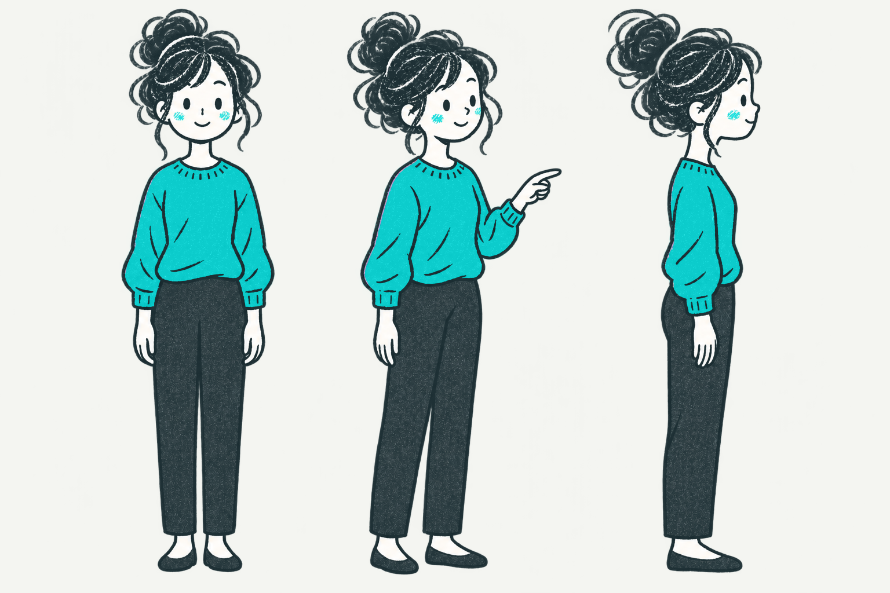
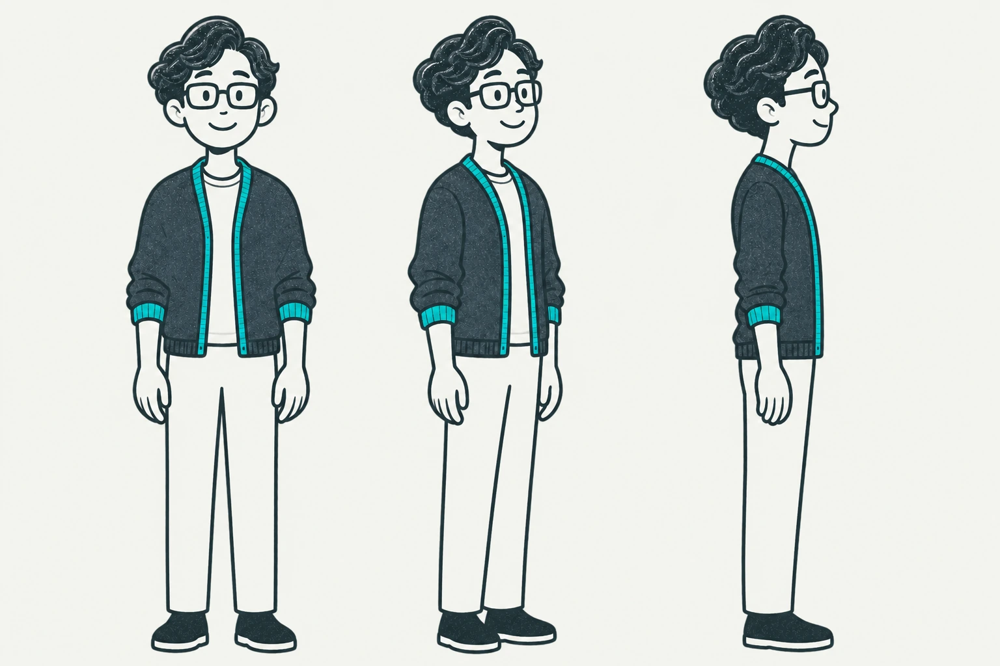
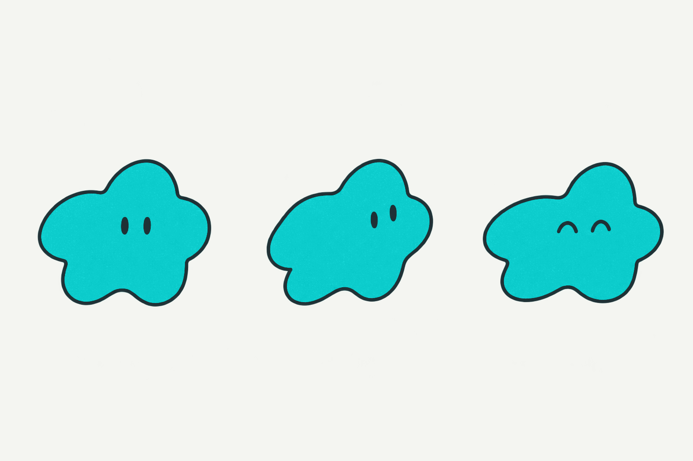
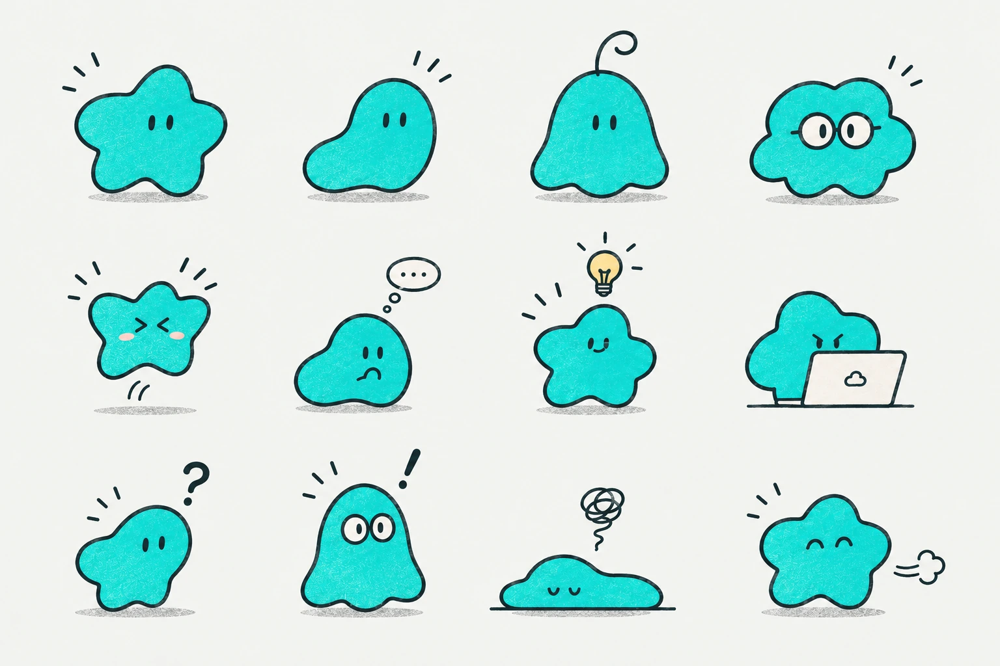

# 캐릭터 시트

Office Notes Cartoon × 리소그래프 삽화의 실무자·관리자·AI 참조다. 단색 종이 배경 `#F4F5F1`, 가늘고 균일한 청회색 펜선 `#1F3136`, 청록 강조색 `#0CCCCC`을 사용한다. 인쇄 질감은 피사체에만 가볍게 넣고, 얼굴과 손은 종이 바탕색으로 둔다. 사용자가 지정한 프로젝트 가이드가 있으면 해당 기준을 적용한다.

장면과 구도를 먼저 정하고 필요한 캐릭터의 이미지를 실제로 열어 확인한다. 생성 도구에 참조를 넘길 때는 얼굴·머리·복장·신체 비율과 화풍을 계승하도록 지정한다. 표정·자세·시선·소품은 새 장면에 맞춘다.

## 실무자

- 짙은 웨이브 머리를 정수리 뒤쪽에 높게 묶는다. 옆으로 넘긴 앞머리와 뺨 옆 곱슬 가닥, 둥근 얼굴·작은 타원형 눈·옅은 청록색 볼 터치를 유지한다.
- 둥근 목둘레와 골지 소매의 청록색 니트, 짙은 일자 바지, 굽 낮은 짙은 신발을 입힌다.
- 자료를 정리하거나 맥락을 전달하거나 초안과 근거를 대조하는 장면에 활용한다.

## 관리자

- 볼륨 있는 짙은 웨이브 머리를 옆으로 넘긴다. 둥근 얼굴, 모서리가 둥근 짙은 사각 안경, 편안한 미소가 특징이다.
- 밝은 라운드넥 티셔츠 위에 짙은 청회색 카디건을 열어 입힌다. 앞단과 소맷단은 가늘게 청록색을 두른다. 종이색 일자 바지와 종이색 밑창이 있는 청회색 운동화를 신긴다.
- 맡길 범위를 설명하거나 판단 기준을 짚거나 초안을 검토하는 장면에 활용한다.

## 청록색 AI

- 손바닥 크기의 청록색 몸체와 짙은 세로 타원형 눈 두 개를 유지한다. 기본 윤곽은 오른쪽 위가 높고 왼쪽이 둥글게 넓다. 기본 표정에서는 입을 생략한다.
- 장면에 맞춰 둥근 별·콩알·종 모양으로 바꾸거나 바닥에 납작하게 퍼지게 그린다. 표정은 눈과 몸짓으로 먼저 표현한다.

